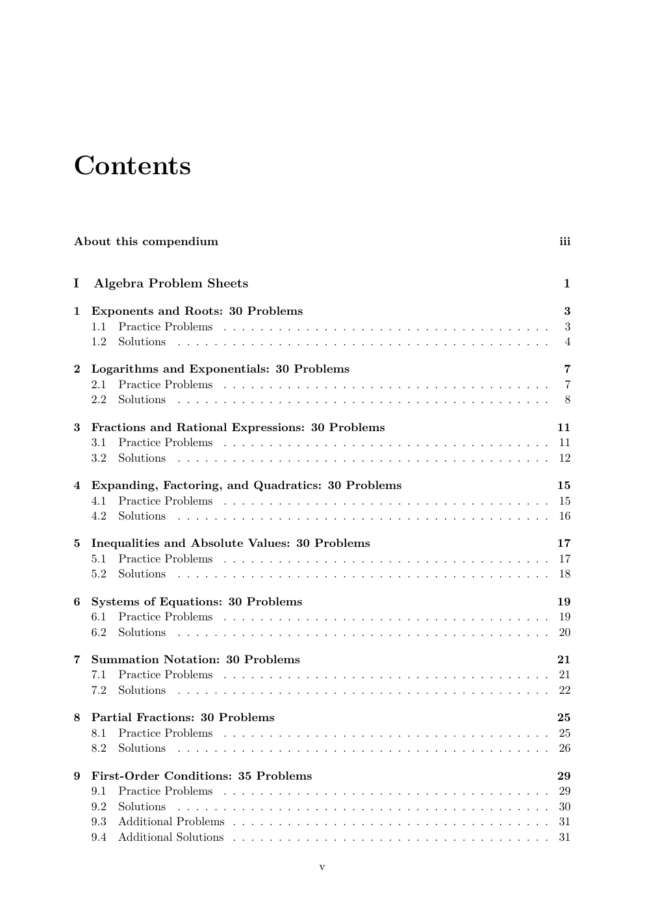
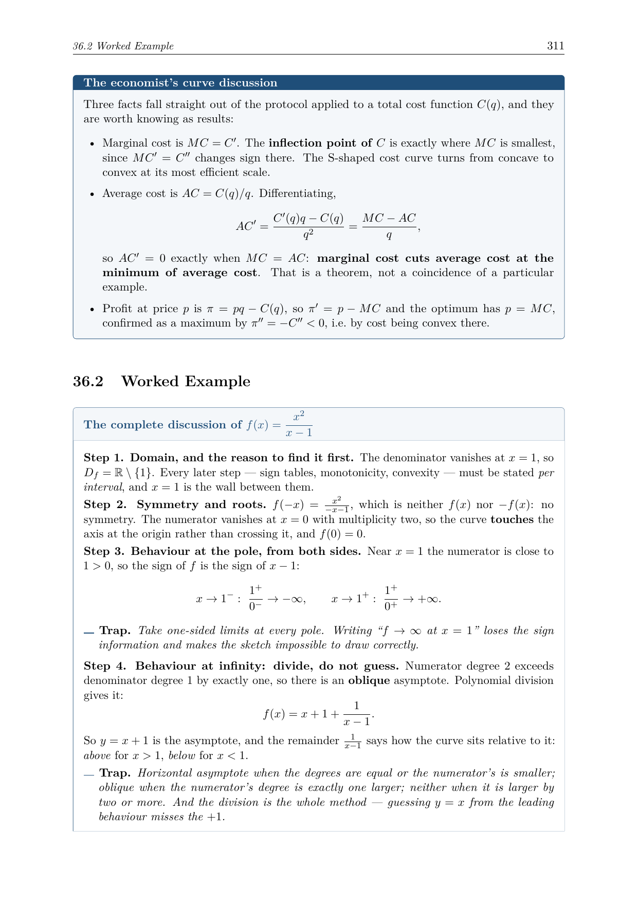
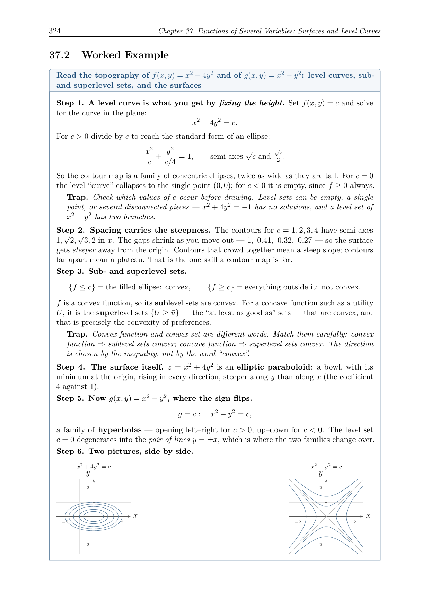
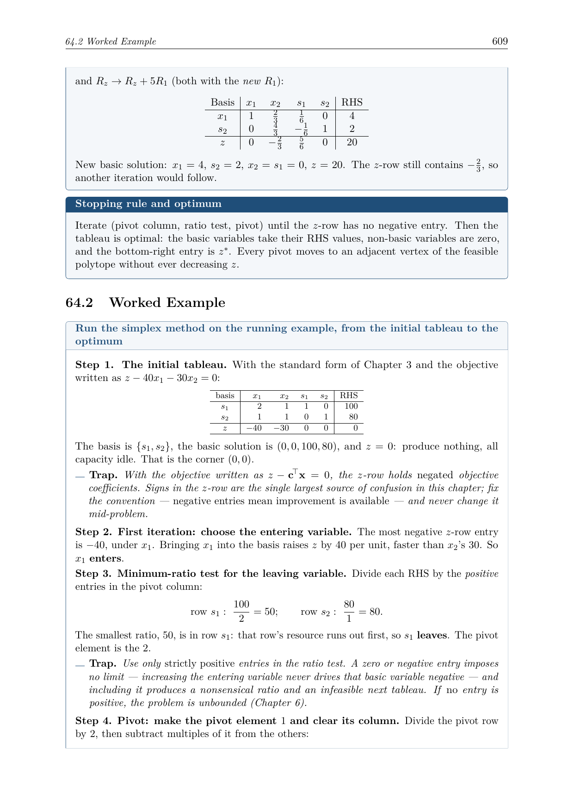

# Basic Mathematics for Economics

I have compiled these exercise books because I needed a refresher in university-level basic to semi advanced mathematics, and I am the type of learner who needs a lot of exercises, plus the option to review the results, to get things into my head. **The exercises and the descriptions were generated by Claude**, working from my own study notes and the standard syllabus of an economics mathematics sequence. So kudos to Claude Opus 5 for it. I have checked most of the exercise results myself, and that is still a work in progress, so if you find an answer to be wrong please let me know. You are free to use and distribute this. If you found it helpful, consider donating: [PayPal](https://www.paypal.com/donate/?hosted_button_id=6CJF5ELH3YJ4E)

Nine LaTeX training books plus a combined compendium, covering the mathematics an economics or business degree expects: from algebra, sequences and financial mathematics, through single- and multivariable calculus and linear algebra, to constrained optimization and linear programming. The emphasis throughout is on drill, with a fully worked solution for every single problem.

Every chapter has the same shape: **Core Rules** state the rules compactly, a **Worked Example** solves one representative problem end to end — narrated step by step, with the standard traps called out where they occur and every result checked — **Practice Problems** drill the technique, **Solutions** work every problem through in full, and most chapters close with an extra block of additional problems for a second pass. One deliberate exception: Volume 9 has worked examples but no rules section, since the point there is that you are not told which method to reach for.
Its fourth set, the full investigations, is the one place it states rules: a short section listing the chain of steps every investigation follows.

## What's inside

The volumes are numbered in the order they are meant to be worked. If the
algebra has gone rusty, Volume 1 is where to get reacquainted before
anything else, and Volume 2 is the one to read next: nearly everything in
the later volumes assumes you can already picture a function.

| Vol. | Document | Chapters | Problems | Pages |
|---|---|---|---|---|
| 1 | Algebraic Foundations: exponents, logarithms, factoring, inequalities, systems, summation, partial fractions, first-order conditions | 9 | 275 | 51 |
| 2 | Functions and Their Graphs: domain and range, the standard graphs, transformations and inverses, shifted conics, regions in the plane, trigonometry | 5 | 400 | 73 |
| 3 | Matrix Algebra: vectors, determinants, Gaussian elimination, inverses, eigenvalues, definiteness | 10 | 525 | 94 |
| 4 | Foundations of Analysis: sequences, series, financial mathematics, limits & continuity | 4 | 120 | 44 |
| 5 | Derivatives & Partial Derivatives: differentiation rules, L'Hôpital, curve discussion, surfaces and level curves, differentiability and tangent planes, gradient, Hessian, Jacobians, inverse and implicit function theorems | 14 | 1133 | 228 |
| 6 | Integration: substitution, parts, partial fractions, improper and double integrals | 8 | 345 | 71 |
| 7 | Static Optimization: convexity, Lagrange, Kuhn–Tucker | 10 | 513 | 145 |
| 8 | Linear Programming: simplex, duality, sensitivity | 8 | 208 | 125 |
| 9 | Mixed Problems: three cross-chapter sets with no method announced, plus full investigations of single functions | 4 | 65 | 28 |
|   | **Total** | **72** | **3584** | **859** |

The compendium, *Basic Mathematics for Economics*, binds all nine volumes
into one 855-page book, in the same order. It opens with **How to Work This
Book** — a diagnostic and a ten-stage study plan that reorders the material
into the sequence a business or economics mathematics course actually needs
it in, with a mastery
test for each stage — and closes with a formula summary and a German–English
glossary. Every problem has a fully worked solution.

## A look inside

| | |
|---|---|
|  |  |
|  |  |

## Repository layout

```
math/
├── algebra/tex/        Vol. 1  Algebraic Foundations
├── functions/tex/      Vol. 2  Functions and Their Graphs
├── matrices/tex/       Vol. 3  Matrix Algebra
├── foundations/tex/    Vol. 4  Foundations of Analysis
├── derivatives/tex/    Vol. 5  Derivatives & Partial Derivatives
├── integrals/tex/      Vol. 6  Integration
├── optimization/tex/   Vol. 7  Static Optimization
├── linprog/tex/        Vol. 8  Linear Programming
├── mixed/tex/          Vol. 9  Mixed Problems (cross-chapter sets)
├── compendium/tex/     all volumes as one book; \input's the volume
│                       chapter files BY REFERENCE; edit content in the
│                       volumes, never here. Its own back matter
│                       (formulas.tex, glossary.tex) lives here
├── tools/              solution checker (sympy)
└── assets/             screenshots for this README
```

Each volume directory contains `main.tex`, the shared `preamble.tex`, a
`Makefile`, and its `chapters/`. (Not tracked: compiled PDFs, personal
scans of early printouts, and local notes)

## Building

Each volume: `cd <vol>/tex && make` (two pdflatex passes for the table of
contents); `make clean` removes aux files. The same works in
`compendium/tex`. Requires `pdflatex` with `tcolorbox`, `enumitem`,
`fancyhdr`, `microtype`, `amsmath`, and `pgfplots` (function graphs, plane
regions and surfaces; no gnuplot or shell-escape needed). All ten
documents compile with **zero errors**; keep it that way.

`python3 tools/check.py` verifies the structural invariant across every
chapter, and `tools/verify/` holds the sympy scripts that re-check the
computational answers.

## House style (follow this when adding chapters)

`preamble.tex` defines everything; do not redefine these or invent others:

- `\begin{rulebox}{Title}…\end{rulebox}`: one box per named rule
- `\begin{worked}{Task}…\end{worked}`: the chapter's worked example, with
  `\wstep{Step n. …}` opening each step and `\wtrap{…}` marking a pitfall
- `\begin{problems}…\end{problems}` / `\begin{solutions}…\end{solutions}` with `\item`
- `\de{German term}`, `\R`, `\dd{y}{x}`, `\pd{f}{x}`, `\pdd{f}{x}{y}`, `\grad`, `\Hess`
- figures: a `tikzpicture` whose `axis` carries one of the house styles —
  `fnaxis` (function graphs), `geoaxis` (square and gridded, for plane
  regions and implicit curves), `contouraxis` (level-curve maps), or
  `surfaxis` (3-D surfaces via `\addplot3[surf]`) — wrapped in
  `\begin{gallery}…\end{gallery}`, pictures separated by `\hfill`, optional
  caption via `\gcap{…}`
- shaded regions: restrict the *named paths'* domains to the region, then
  `\region{pathA}{pathB}{}`. Do not use pgfplots' `soft clip`; it fills the
  complement
- `\mathrm{e}` for Euler's number, `\mathrm{d}x` for differentials

Chapter skeleton: `\chapter` → intro prose → `\section{Core Rules}` →
`\section{Worked Example}` → `\section{Practice Problems}` →
`\section{Solutions}` → `\section{Additional Problems}` →
`\section{Additional Solutions}` (the Additional pair is present in most,
not all, chapters; Volume 9 has no Core Rules by design, except for the
chain-of-steps section that opens its fourth set).

**Invariants worth keeping**: every chapter carries exactly one
`\section{Worked Example}` (plural title where it holds two boxes), and the
problem count must equal the solution count in every chapter. A chapter may hold several `problems`/`solutions`
environment pairs (Practice plus Additional), so the totals are what has to
match, not the individual blocks.

## Provenance

The volumes grew out of personal study sheets. They were consolidated with Claude, 
expanded with additional-exercise blocks, and completed with newly authored chapters
(Taylor approximation, vectors, sequences and series, financial mathematics,
limits and continuity, functions with their domains, graphs and
transformations, regions in the plane, trigonometry, L'Hôpital, curve
discussion, surfaces and level curves, Gaussian elimination, and the mixed
sets of Volume 8) until the usual syllabus of an economics mathematics
sequence was covered end to end.
Solutions are step-by-step by design. Checking them is an ongoing effort, so
reports of wrong answers are very welcome.

## License

All exercises and content in this repository are licensed under
[CC BY-NC-SA 4.0](https://creativecommons.org/licenses/by-nc-sa/4.0/).
