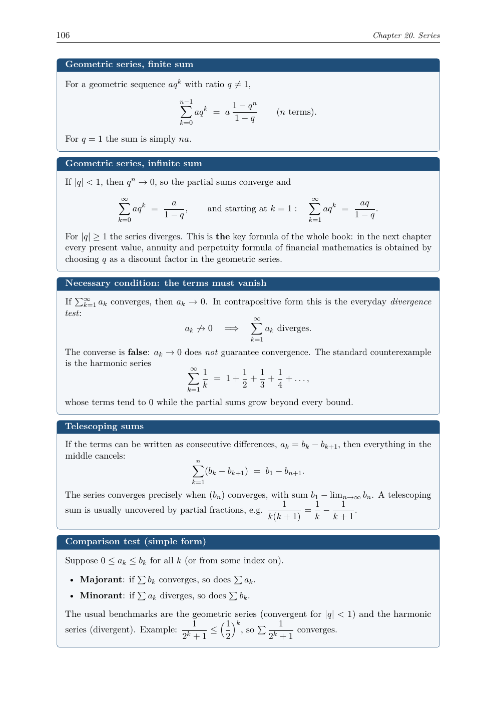

# Basic Mathematics for Economics

I have compiled these exercise books because I needed a refresher in university-level basic to semi advanced mathematics, and I am the type of learner who needs a lot of exercises, plus the option to review the results, to get things into my head. **The exercises and the descriptions were generated by Claude**, working from my own study notes and the standard syllabus of an economics mathematics sequence. So kudos to Claude Opus 5 for it. I have checked most of the exercise results myself, and that is still a work in progress, so if you find an answer to be wrong please let me know. You are free to use and distribute this. If you found it helpful, consider donating: [PayPal](https://www.paypal.com/donate/?hosted_button_id=6CJF5ELH3YJ4E)

Six LaTeX training books plus a combined compendium, covering the mathematics an economics or business degree expects: from algebra, sequences and financial mathematics, through single- and multivariable calculus and linear algebra, to constrained optimization and linear programming. The emphasis throughout is on drill, with a fully worked solution for every single problem.

Every chapter has the same shape: **Core Rules** state the rules compactly, **Practice Problems** drill them, **Solutions** work every problem through in full, and most chapters close with an extra block of additional problems for a second pass.

## What's inside

| Vol. | Document | Chapters | Problems | Pages |
|---|---|---|---|---|
| 0 | Foundations of Analysis: sequences, series, financial mathematics, limits & continuity | 4 | 120 | 39 |
| 1 | Derivatives & Partial Derivatives, incl. Taylor, gradient, Hessian, Implicit Function Theorem | 11 | 725 | 111 |
| 2 | Integration + Algebra Problem Sheets | 8 + 9 | 620 | 98 |
| 3 | Matrix Algebra: vectors through eigenvalues and definiteness | 9 | 442 | 65 |
| 4 | Static Optimization: convexity, Lagrange, Kuhn–Tucker | 10 | 336 | 87 |
| 5 | Linear Programming: simplex, duality, sensitivity | 8 | 182 | 90 |
|   | **Total** | **59** | **2425** | **490** |

The compendium, *Basic Mathematics for Economics*, binds all six volumes
into one book of seven parts, ordered as a course of study. Every problem
has a fully worked solution.

## A look inside

| | |
|---|---|
|  |  |
|  |  |

## Repository layout

```
math/
├── foundations/tex/    Vol. 0  Foundations of Analysis
├── derivatives/tex/    Vol. 1  Derivatives & Partial Derivatives
├── integrals/tex/      Vol. 2  Integration + Algebra Problem Sheets
├── matrices/tex/       Vol. 3  Matrix Algebra
├── optimization/tex/   Vol. 4  Static Optimization
├── linprog/tex/        Vol. 5  Linear Programming
├── compendium/tex/     all volumes as one book; \input's the volume
│                       chapter files BY REFERENCE; edit content in the
│                       volumes, never here
└── assets/             screenshots for this README
```

Each volume directory contains `main.tex`, the shared `preamble.tex`, a
`Makefile`, and its `chapters/`. (Not tracked: compiled PDFs, personal
scans of early printouts, and local notes)

## Building

Each volume: `cd <vol>/tex && make` (two pdflatex passes for the table of
contents); `make clean` removes aux files. The same works in
`compendium/tex`. Requires `pdflatex` with `tcolorbox`, `enumitem`,
`fancyhdr`, `microtype`, and `amsmath`. All seven documents compile with
**zero errors**; keep it that way.

## House style (follow this when adding chapters)

`preamble.tex` defines everything; do not redefine these or invent others:

- `\begin{rulebox}{Title}…\end{rulebox}`: one box per named rule
- `\begin{problems}…\end{problems}` / `\begin{solutions}…\end{solutions}` with `\item`
- `\de{German term}`, `\R`, `\dd{y}{x}`, `\pd{f}{x}`, `\pdd{f}{x}{y}`, `\grad`, `\Hess`
- `\mathrm{e}` for Euler's number, `\mathrm{d}x` for differentials

Chapter skeleton: `\chapter` → intro prose → `\section{Core Rules}` →
`\section{Practice Problems}` → `\section{Solutions}` →
`\section{Additional Problems}` → `\section{Additional Solutions}` (the
Additional pair is present in most, not all, chapters).

**Invariant worth keeping**: the problem count must equal the solution count
in every chapter. A chapter may hold several `problems`/`solutions`
environment pairs (Practice plus Additional), so the totals are what has to
match, not the individual blocks.

## Provenance

The volumes grew out of personal study sheets. They were consolidated with Claude, 
expanded with additional-exercise blocks, and completed with newly authored chapters
(Taylor approximation, vectors, sequences and series, financial mathematics,
limits and continuity, most of the linear-programming volume) until the
usual syllabus of an economics mathematics sequence was covered end to end.
Solutions are step-by-step by design. Checking them is an ongoing effort, so
reports of wrong answers are very welcome.

## License

All exercises and content in this repository are licensed under
[CC BY-NC-SA 4.0](https://creativecommons.org/licenses/by-nc-sa/4.0/).
